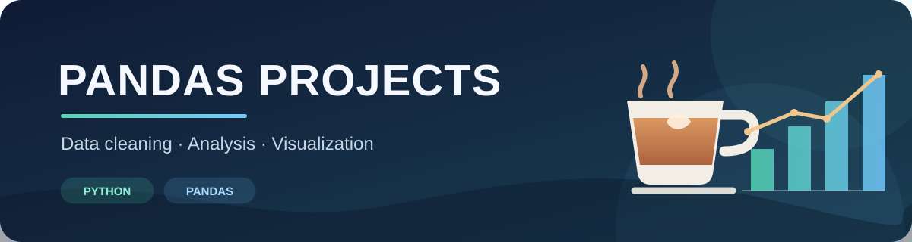

# Pandas Projects

> A growing collection of practical projects in data cleaning, analysis, and visualization with Python and pandas.

This repository is a portfolio of data projects. Each project explores a dataset, investigates useful questions, and summarizes its findings.

## Projects

### Coffee Shop Sales Analysis

Explore transaction-level coffee shop sales to understand product-category revenue, store performance, daily activity, and customer purchase quantities.

- **Project folder:** [`coffee_sales_analysis/`](./coffee_sales_analysis/)
- **Notebook:** [Coffee shop analysis](./coffee_sales_analysis/coffee-shop-pandas-analyis.ipynb)
- **Project README:** [Coffee Shop Sales Analysis](./coffee_sales_analysis/README.md)
- **Tools:** Python, pandas, Matplotlib, Seaborn, Jupyter

The notebook examines data quality, cleans a practice dataset, calculates revenue, and explores the results with charts. Its conclusion highlights coffee as the leading revenue category, Hell's Kitchen as the top store, and one or two items as the most common transaction size.

### More projects

Additional pandas projects will be added here as they are completed.

## Run a project

Install Python, then install the packages used by the coffee shop notebook:

```powershell
python -m pip install pandas matplotlib seaborn jupyter
```

The notebook currently reads `Coffee Shop Sales - pandas practice .csv` from its working directory. Obtain the dataset separately, place it beside the notebook in `coffee_sales_analysis/`, open the notebook in Jupyter or Visual Studio Code, and run its cells from top to bottom.

## Repository layout

```text
pandas_project/
├── README.md
├── pandas-project-banner.svg
├── coffee_sales_analysis/
│   ├── README.md
│   ├── coffee-shop-pandas-analyis.ipynb
│   └── Coffee Shop Sales - pandas practice .csv  # local-only; not committed
└── data/
    └── Coffee Shop Sales.csv                     # local-only; not committed
```

CSV datasets are excluded from version control, so they are not downloaded with this repository. Before sharing or publishing any data, confirm that its license permits redistribution and follow any attribution requirements.

## Analysis workflow

1. Inspect columns, data types, missing values, and duplicate rows.
2. Clean and prepare the data for analysis.
3. Group transactions to compare sales by category, product, store, or date.
4. Visualize patterns and check that conclusions match the results.
5. Summarize findings and possible business actions.
